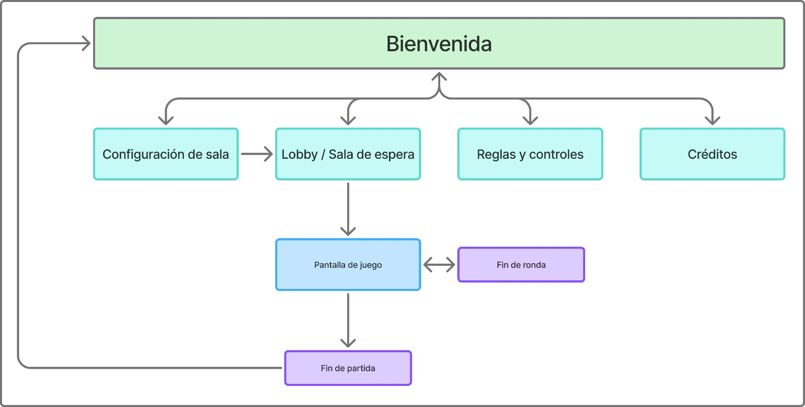

# Proyecto Final: Arcade Distribuido

**CI-0137 - Desarrollo de Aplicaciones Web**

## Etapa #1: Propuesta y aprobación del juego

**Profesora:**\
Mariana Núñez Arguedas

**Integrantes:**\
Alejandro Guerra Rodríguez - C13451\
Felipe Corrales Barrientos - C4E485\
Jafet Araya Góngora - C4C527\
Sebastián Herrera Rivera - C4G049

## Idea general

El juego está inicialmente planteado para ser multijugador con dos participantes (aunque en el futuro podría ampliarse a dos equipos de cualquier tamaño). Uno de ellos asumirá el rol de atrapador y el otro el rol de corredor, es decir siguiendo la dinámica de un policías y ladrones o “la anda”. El trabajo del atrapador es lograr atrapar al corredor antes de un tiempo límite definido. Por la otra parte, el rol del corredor es lograr huir hasta que se cumpla el tiempo límite. De esta manera el juego se rige por rondas,  las cuáles quedan acotadas por un rango de tiempo dado. Para cada ronda gana el jugador que logre completar su tarea con éxito (atrapar o escapar). Finalmente, gana el jugador con más rondas ganadas.

## Reglas propias de la mecánica

1. El mapa tendrá tres tipos de estructuras principales.

   a. Paredes: No permiten que los jugadores las traspasen. Se utilizan para definir los límites del mapa y pueden estar presentes dentro del mismo.
   
   b. Plataformas: Actúan como superficie sobre las que los jugadores pueden estar. Permiten que los jugadores salten y desciendan de estas con libertad.
   
   c. Puertas: Secciones específicas que actúan como una puerta. Cuando están abiertas pueden ser traspasadas, cuando están cerradas no.
   
2. El corredor puede realizar un dash (desplazamiento rápido) hacia cualquier dirección sobre el plano del mapa. Tras ser usado, el ladrón debe esperar una cantidad de segundos antes de realizar el siguiente dash. No hay un límite de dashes en la partida.

3. El atrapador puede disparar un arma. La bala recorrerá una línea recta hasta alcanzar al corredor o una pared. El movimiento será instantáneo, por lo que solo atrapará al corredor si este se encuentra en la trayectoria de fuego al momento del disparo. Si el arma no impacta con este, se ralentiza el movimiento del atrapador brevemente. Si el arma alcanza al corredor, ralentiza su movimiento por unos segundos. El atrapador debe esperar a que su arma se recargue antes de poder volver a utilizarla. No hay límite de disparos en la partida.

4. El mapa va a habilitar plataformas en posiciones específicas. Ambos jugadores pueden saltar y descender de las plataformas. Tanto el dash como el disparo del arma pueden traspasar las plataformas sin afectar sus mecánicas respectivas.

5. El mapa va a contar con puertas en distintas posiciones. Si la puerta está abierta, ambos jugadores pueden atravesarla. Si la puerta está cerrada, ningún jugador puede atravesarla. El corredor puede cerrar la puerta al estar un par de segundos sobre ella. La puerta se abrirá automáticamente después de un tiempo.

## Información de sincronización

Para que el juego se desenvuelva correctamente, la siguiente información debe sincronizarse entre los jugadores y el servidor, para este caso llámese JA el jugador atrapador y JC al jugador corredor:

* Entradas de usuario: Teclas/ratón presionados por ambos jugadores en cada momento, junto con su respectivo timestamp (marca de tiempo).
* Manejo de posición y vectores de movimiento.
* Cálculo de hitboxes, no se solapan, sino que JA atrapa a JC.
* Estado de la partida: eventos de juego.
* Tiempo de juego restante: reloj global controlado por el servidor.
* Paredes: el servidor valida y limita los vectores de movimiento de JA y JC.
* Manejo de ubicación en mapa y movimientos.
* Menús de juego y teclas especiales: Interfaz visual y representación gráfica de acciones según el estado de juego.
* Tabla de ganadores - mayores puntajes.

## Roles de equipo

* Frontend/maquetado: Sebastián.
* Cliente/lógica de juego (JavaScript): Felipe
* Servidor/comunicación: Jafet.
* Diseño/QA/coordinación: Alejandro.

## Cumplimiento de requisitos

Cuadro 1. Análisis sobre el cumplimiento de los requisitos.

| Requisito | Observación | ¿Se cumple? |
|---|---|---|
| Multijugador real. | En su versión base son necesarios 2 jugadores. | Sí. |
| Mérito sobre azar. | El azar se encuentra presente en factores como el rol de los participantes (opcional) o las ubicaciones donde aparecen ciertos elementos especiales. Sin embargo, la victoria dependerá de la estrategia individual de cada jugador y su elección en cómo aprovechar los recursos disponibles en el mapa. | Sí. |
| Turnos o tiempo real. | La naturaleza del juego exige que se desenvuelva en tiempo real para ambos participantes. | Sí. |
| Condición de fin explícita. | Se llega al final de una partida cuando el corredor es atrapado o el tiempo acaba (no lo atrapan). El corredor gana si logra escapar, pierde en caso contrario. Gana el jugador que haya ganado más partidas. | Sí. |
| Mínimo de 5 reglas propias que definan la mecánica. | Ver al final del cuadro. | Sí. |
| Identidad propia. | El juego adopta un concepto ya existente: “policías y ladrones”. Sin embargo, las mecánicas introducidas en el juego fueron pensadas por el equipo. | Sí. |

## Sitemap
Sitemap y flujo de navegación básico.

## Wireflow
El wireflow se desarrolló como un prototipo de baja fidelidad que contectaba los wireframes digitales previamente creados. El mismo se puede visualizar en el siguiente enlace: [wireflow](https://www.figma.com/proto/HbBErAGWRE54kvbchXPBum/Wireframes-y-Wireflow?node-id=3-3&p=f&t=Z2KZ14S1FUJYVxws-1&scaling=min-zoom&content-scaling=fixed&page-id=0%3A1&starting-point-node-id=3%3A3)